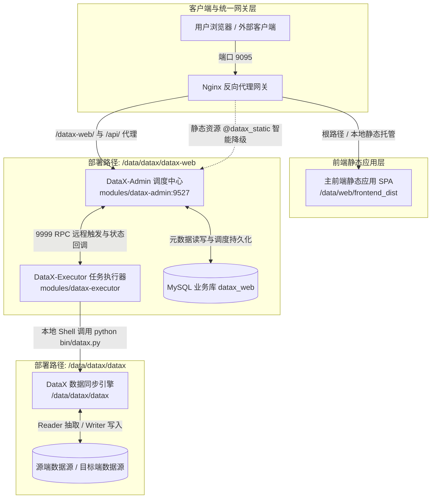
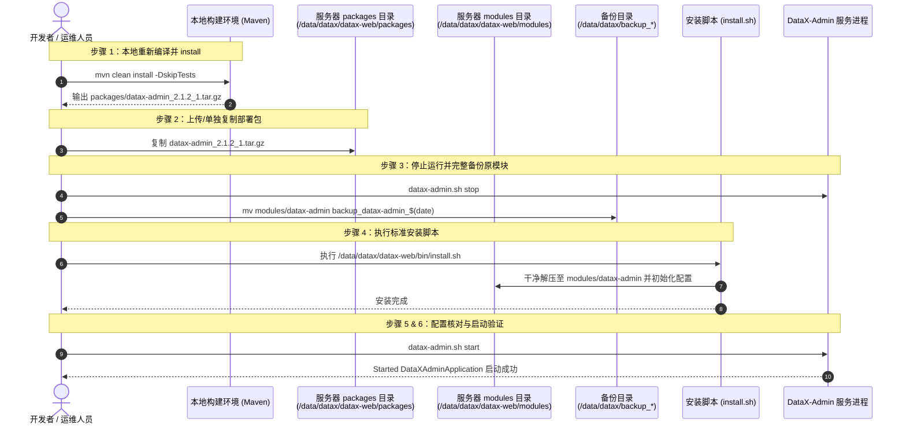

<!--
@author: ypc
@description: DataX 与 DataX-Web 测试/生产环境部署、运维与反向代理操作手册
@date: 2026-09-03
-->

# DataX 与 DataX-Web 部署运维及反向代理操作手册

本文档针对 DataX 计算引擎及 DataX-Web 可视化任务调度平台的生产与测试环境部署、运行维护、配置调整及 Nginx 网关反向代理进行全方位规范说明。

---

## 一、 系统架构与网络拓扑




---

## 二、 环境访问地址与认证凭证

### 1. 访问地址
* **测试环境**：
  * **IP 访问**：`http://<测试服务器IP>:9095/datax-web/index.html`
  * **测试域名访问**：`http://test.yourdomain.com:9095/datax-web/index.html`
* **正式环境**：
  * **生产域名访问**：`http://datax.yourdomain.com:9095/datax-web/index.html`

### 2. 默认账号与密码
* **初始账号**：admin
* **初始密码**：123456
* **修改后密码**：`<实际生产密码>`（首次部署登录后请立即修改）
* **角色权限**：超级管理员（`ROLE_ADMIN`）

---

## 三、 部署路径与目录规划

| 系统组件 | 部署绝对路径 | 说明与关键子路径 |
| :--- | :--- | :--- |
| **DataX 引擎** | `/data/datax/datax` | 核心执行脚本：`/data/datax/datax/bin/datax.py`<br/>插件目录：`/data/datax/datax/plugin/` |
| **DataX-Web 根目录** | `/data/datax/datax-web` | 全局脚本入口：`/data/datax/datax-web/bin/`<br/>安装包解压目录：`/data/datax/datax-web/modules/` |
| ├─ **Admin 管理端** | `/data/datax/datax-web/modules/datax-admin` | 程序路径：`bin/datax-admin.sh`<br/>配置路径：`conf/application.yml`、`bin/env.properties`<br/>日志路径：`logs/datax-admin.log` |
| └─ **Executor 执行器** | `/data/datax/datax-web/modules/datax-executor` | 程序路径：`bin/datax-executor.sh`<br/>配置路径：`conf/application.yml`、`bin/env.properties`<br/>日志路径：`logs/datax-executor.log` |

---

## 四、 启停控制与进程运维命令

### 1. 一键启停命令（推荐）
在 `/data/datax/datax-web/bin` 目录下提供了一键控制脚本：
```bash
# 启动全部组件（按顺序自动拉起 Admin 与 Executor）
/data/datax/datax-web/bin/start-all.sh

# 停止全部组件
/data/datax/datax-web/bin/stop-all.sh
```

### 2. 单模块精细化管理命令
* **DataX-Admin（调度控制中心）**：
  ```bash
  # 启动
  /data/datax/datax-web/modules/datax-admin/bin/datax-admin.sh start
  
  # 停止
  /data/datax/datax-web/modules/datax-admin/bin/datax-admin.sh stop
  
  # 重启
  /data/datax/datax-web/modules/datax-admin/bin/datax-admin.sh restart
  
  # 查看运行状态与 PID
  /data/datax/datax-web/modules/datax-admin/bin/datax-admin.sh status
  ```

* **DataX-Executor（任务执行器）**：
  ```bash
  # 启动
  /data/datax/datax-web/modules/datax-executor/bin/datax-executor.sh start
  
  # 停止
  /data/datax/datax-web/modules/datax-executor/bin/datax-executor.sh stop
  
  # 重启
  /data/datax/datax-web/modules/datax-executor/bin/datax-executor.sh restart
  
  # 查看运行状态与 PID
  /data/datax/datax-web/modules/datax-executor/bin/datax-executor.sh status
  ```

---

## 五、 核心配置文件与修改说明

### 1. DataX-Admin 配置

#### (1) `modules/datax-admin/bin/env.properties`
```properties
# Web 服务端口号（默认 9527）
SERVER_PORT=9527

# 日志输出目录
WEB_LOG_PATH=${BIN}/../logs

# 内部持久化数据路径
DATA_PATH=${BIN}/../data
```

#### (2) `modules/datax-admin/conf/application.yml`
```yaml
server:
  port: 9527

spring:
  datasource:
    # 数据库连接地址，必须确保字符集为 utf8/utf8mb4，时区对齐
    url: jdbc:mysql://127.0.0.1:3306/datax_web?serverTimezone=Asia/Shanghai&useUnicode=true&characterEncoding=UTF-8&useSSL=false
    username: root
    password: 实际数据库密码
    hikari:
      minimum-idle: 5
      maximum-pool-size: 10
      connection-timeout: 30000
```

---

### 2. DataX-Executor 配置

#### (1) `modules/datax-executor/bin/env.properties`
```properties
# Executor Web 服务端口
SERVER_PORT=9504

# 执行器与 Admin RPC 通信端口
EXECUTOR_PORT=9999

# 对应 DataX-Admin 的端口（保持一致）
DATAX_ADMIN_PORT=9527

# 【重要】DataX 核心 Python 脚本路径
PYTHON_PATH=/data/datax/datax/bin/datax.py
```

#### (2) `modules/datax-executor/conf/application.yml`
```yaml
server:
  port: 9504

datax:
  job:
    admin:
      # 指向 DataX-Admin 调度服务
      addresses: http://127.0.0.1:9527
    executor:
      appname: datax-executor
      ip:
      port: 9999
      logpath: ./data/applogs/executor/jobhandler
      logretentiondays: 30
  # 【重要】DataX 执行入口，需与实际安装路径完全一致
  pypath: /data/datax/datax/bin/datax.py
```

---

## 六、 详细部署说明（从零到一）

### 步骤 1：系统依赖准备
确保服务器已安装 `Java 1.8+` 及 `Python 2.7 或 Python 3.x`：
```bash
java -version
python --version
```

### 步骤 2：初始化 MySQL 数据库
进入 MySQL 执行建表脚本：
```sql
CREATE DATABASE IF NOT EXISTS `datax_web` DEFAULT CHARACTER SET utf8mb4 COLLATE utf8mb4_general_ci;
USE `datax_web`;

-- 1. 导入 DataX-Web 原生基础库表结构
SOURCE /data/datax/datax-web/bin/db/datax_web.sql;

-- 2. 导入增强特性扩展表 (包含表映射模板、数据对账日志、元数据漂移审计等扩展支持)
SOURCE /data/datax/datax-web/bin/db/datax_web_mapping_increment.sql;

-- 3. 导入统计计算任务扩展表与权限菜单 (可选增强模块)
SOURCE /data/datax/datax-web/bin/db/datax_web_stat_task.sql;
```

### 步骤 3：赋予脚本执行权限
```bash
chmod -R +x /data/datax/datax/bin/
chmod -R +x /data/datax/datax-web/bin/
chmod -R +x /data/datax/datax-web/modules/datax-admin/bin/
chmod -R +x /data/datax/datax-web/modules/datax-executor/bin/
```

### 步骤 4：启动与验证
```bash
# 启动所有模块
/data/datax/datax-web/bin/start-all.sh

# 查看端口监听情况（9527 与 9504 应处于 LISTEN 状态）
netstat -tulnp | grep -E '9527|9504|9999'
```

---

## 七、 日志查看与故障排查命令

```bash
# 1. 实时跟踪 DataX-Admin 业务运行日志
tail -f -n 100 /data/datax/datax-web/modules/datax-admin/logs/datax-admin.log

# 2. 查看 DataX-Admin 启动控制台输出 (排查 JVM 启动崩溃、数据库连接失败)
tail -f -n 100 /data/datax/datax-web/modules/datax-admin/bin/console.out

# 3. 实时跟踪 DataX-Executor 任务执行器日志
tail -f -n 100 /data/datax/datax-web/modules/datax-executor/logs/datax-executor.log

# 4. 查看具体 DataX 任务的底层运行日志 (同步行数、吞吐速度、脏数据详情)
tail -f /data/datax/datax-web/modules/datax-executor/data/applogs/executor/jobhandler/*/*.log

# 5. 查看 Nginx 反向代理访问日志与错误排查日志
tail -f /opt/nginx-1.24.0/logs/error.log
tail -f /opt/nginx-1.24.0/logs/access.log
```

---

## 八、 生产就绪的 Nginx 配置文件 (适配前端静态应用与 DataX-Web 前端共存)

```bash
cd /opt/nginx-1.24.0
vi conf/nginx.conf

# 语法检测与平滑重启
./sbin/nginx -t
./sbin/nginx -s reload
```

### 架构设计与核心问题解决方案说明
此配置专门用于在 **同一端口/统一网关（如 9095）下实现独立前端静态应用（SPA）与 DataX-Web 前端管理平台双应用并存**，解决了以下关键问题：
1. **双前端 `/static/` 静态资源智能分流与优雅降级**：
   * 主前端静态应用与 DataX-Web 前端均包含静态资源路径（`/static/`）；
   * 采用 `try_files $uri @datax_static;` 机制：优先从本地磁盘读取主前端静态构建文件，当遇到 DataX-Web 自身的前端资源（如 `element-icons.woff` 字体、专属 CSS/JS）本地不存在时，无缝透明代理回源至 DataX-Web 内部服务（`127.0.0.1:9527`），彻底根治静态资源冲突与白屏问题；
2. **路由前缀平滑剥离**：子路径 `/datax-web/` 通过 `rewrite ^/datax-web/(.*)$ /$1 break;` 自动剥离前缀，无缝对齐 DataX-Admin 根路径映射；
3. **接口智能拦截与鉴权转发**：拦截前端硬编码发起的绝对路径 `/api/*` 请求并反代回源；
4. **Cookie 作用域隔离**：通过 `proxy_cookie_path / /datax-web/;` 重写作用域，保障 Token/Session 彼此隔离互不干扰。

```nginx
server {
    listen      9095;
    server_name 127.0.0.1 <服务器IP> <你的业务域名>;

    # ==================== 1. 主前端独立静态单页应用 (根路径 /) ====================
    location / {
        root   /data/web/frontend_dist;    # 主前端静态构建产物路径 (如 Vue/React dist 目录)
        try_files $uri $uri/ /index.html;  # 支持前端路由 History 模式
        index  index.html index.htm;
    }

    # ==================== 2. DataX-Web 前端与管理服务代理 (/datax-web/) ====================
    
    # 2.1 补全末尾斜杠，避免被根路径 location / 误匹配
    location = /datax-web {
        return 301 $scheme://$http_host/datax-web/;
    }

    # 2.2 DataX-Web 前端主入口 (剥离 /datax-web/ 前缀代理至 9527 根路径)
    location /datax-web/ {
        rewrite ^/datax-web/(.*)$ /$1 break;
        proxy_pass http://127.0.0.1:9527;

        proxy_set_header Host $http_host;
        proxy_set_header X-Real-IP $remote_addr;
        proxy_set_header X-Forwarded-For $proxy_add_x_forwarded_for;
        proxy_set_header X-Forwarded-Proto $scheme;

        # 核心：重写 Cookie 作用域，防止 Token/Session 跨应用污染
        proxy_cookie_path / /datax-web/;

        # 支持 WebSocket 与长连接大文件传输
        proxy_http_version 1.1;
        proxy_set_header Upgrade $http_upgrade;
        proxy_set_header Connection "upgrade";

        client_max_body_size 2g;
        proxy_buffering off;
        proxy_read_timeout 300s;
    }

    # 2.3 DataX-Web 后端 API 接口反代 (拦截前端发起的 /api/* 请求)
    location /api/ {
        proxy_pass http://127.0.0.1:9527/api/;

        proxy_set_header Host $http_host;
        proxy_set_header X-Real-IP $remote_addr;
        proxy_set_header X-Forwarded-For $proxy_add_x_forwarded_for;
        proxy_set_header X-Forwarded-Proto $scheme;

        proxy_cookie_path / /datax-web/;

        proxy_http_version 1.1;
        proxy_buffering off;
        proxy_read_timeout 300s;
    }

    # 2.4 双前端静态资源智能分流 (主前端本地静态优先，未命中则降级代理给 DataX-Web 前端)
    # 核心机制：本地磁盘优先响应主前端静态文件；遇 DataX-Web 自身资源或字体 (element-icons 等) 自动回源至 9527
    location /static/ {
        root /data/web/frontend_dist;     # 主前端静态构建产物路径
        try_files $uri @datax_static;     # 本地未命中则回源代理
    }

    location @datax_static {
        proxy_pass http://127.0.0.1:9527; # 代理回源至 DataX-Web 前端资源
        proxy_set_header Host $http_host;
        proxy_set_header X-Real-IP $remote_addr;
        proxy_set_header X-Forwarded-For $proxy_add_x_forwarded_for;
        proxy_set_header X-Forwarded-Proto $scheme;
        proxy_http_version 1.1;
    }

    # ==================== 3. 通用错误页与 Favicon ====================
    error_page   500 502 503 504  /50x.html;
    location = /50x.html {
        root   html;
    }

    location /favicon.ico {
        root html;
    }
}
```

---

## 九、 业务代码与前端更新发版规范 (标准化 Install 部署指南)

### 1. 发版机制重要原则与安全红线

> [!CAUTION]
> **【安全红线】严禁使用任何形式的散文件覆盖或局部热更！**
> 1. **严禁只替换 `datax-admin-2.1.2.jar`**：`pom.xml` 中明确将 SQL Mapper XML 排除在 Jar 包外，只换 Jar 包会导致 SQL 逻辑完全不生效。
> 2. **严禁在根目录下解压或手动放置散文件**：Spring Boot 内置 Tomcat 启动时会自动扫描工作目录，手动创建 `static` 等目录会导致 Tomcat 报 `The main resource set specified is not valid` 致命异常导致服务彻底崩溃。
> 3. **唯一标准更新路径**：**必须通过重新 `mvn install` 打包生成完整部署包 `datax-admin_2.1.2_1.tar.gz`，复制到 `packages/` 目录，备份移走原 `modules/datax-admin`，最后通过 `/data/datax/datax-web/bin/install.sh` 进行标准解压安装！**

---

### 2. 标准化发版操作流程 (SOP)



---

#### 步骤 1：本地构建机重新编译打出完整安装包
在工程根目录下执行 Maven 安装打包命令（必须包含 `install` 生命周期，触发 `maven-assembly-plugin` 组装）：
```bash
mvn clean install -DskipTests
```
* 构建成功后，会在项目根目录的 `packages/` 目录下生成完整的安装包：
  * **部署包文件**：`packages/datax-admin_2.1.2_1.tar.gz`
  * （该包内已完整集成了后端的 `lib/*.jar`、外部化配置 `conf/`、前端静态资源 `conf/static/`、Mapper 文件 `conf/mybatis-mapper/` 及控制脚本 `bin/`）。

---

#### 步骤 2：单独复制部署包到服务器 `packages` 目录
将本地打包生成的 `datax-admin_2.1.2_1.tar.gz` 单独上传或拷贝到服务器对应目录：
```bash
# 复制到服务器指定 packages 目录
# 目标路径必须为：/data/datax/datax-web/packages/
ls -lh /data/datax/datax-web/packages/datax-admin_2.1.2_1.tar.gz
```

---

#### 步骤 3：停止现有服务并完整备份原 `datax-admin` 模块

> [!IMPORTANT]
> **必须将原有的 `datax-admin` 移走备份，不可直接就地覆盖！**
> 原因：`/data/datax/datax-web/bin/install.sh` 中的解压命令使用了 `--skip-old-files` 参数，如果目标目录下已有同名旧文件，解压时会自动跳过，导致新文件无法替换旧文件。移走旧目录能保证全新、纯净安装。

在服务器终端执行：
```bash
# 1. 停止运行中的 DataX-Admin 服务
/data/datax/datax-web/modules/datax-admin/bin/datax-admin.sh stop

# 2. 创建备份目录
BACKUP_DIR="/data/datax/backup_datax-admin_$(date +%Y%m%d_%H%M%S)"
mkdir -p ${BACKUP_DIR}

# 3. 将原有的整个 datax-admin 模块完整移动备份（注意是 mv 移走）
mv /data/datax/datax-web/modules/datax-admin ${BACKUP_DIR}/
```

---

#### 步骤 4：执行标准安装脚本 `install.sh`
执行 DataX-Web 官方标准安装脚本完成解包与模块部署：
```bash
/data/datax/datax-web/bin/install.sh
```
* 交互式提示说明：
  * 当脚本提示：`Do you want to decompress this package: [datax-admin_2.1.2_1.tar.gz]? (Y/N)` 时，输入 `Y` 回车。
  * 若服务器仅需更新 Admin 模块，对 executor 的提示按需选择（若无需更新输入 `N` 即可）。
  * 脚本会自动将最新的 `datax-admin_2.1.2_1.tar.gz` 解压至 `/data/datax/datax-web/modules/datax-admin`。

---

#### 步骤 5：环境配置文件核对与按需合并
因为重新安装会释放出源码中的默认配置文件，需核对并恢复生产/测试环境差异化配置（如数据库连接密码等）：
```bash
# 检查对比 application.yml 差异
diff ${BACKUP_DIR}/datax-admin/conf/application.yml /data/datax/datax-web/modules/datax-admin/conf/application.yml

# 若有特定配置需要恢复，可直接将备份的配置合并或单文件还原
# cp -f ${BACKUP_DIR}/datax-admin/conf/application.yml /data/datax/datax-web/modules/datax-admin/conf/application.yml
```

---

#### 步骤 6：启动服务并验证运行状态
```bash
# 1. 启动 DataX-Admin
/data/datax/datax-web/modules/datax-admin/bin/datax-admin.sh start

# 2. 查看运行状态确认 PID
/data/datax/datax-web/modules/datax-admin/bin/datax-admin.sh status

# 3. 跟踪控制台启动日志，确认 Spring Boot 顺利拉起
tail -f -n 50 /data/datax/datax-web/modules/datax-admin/bin/console.out
```

---

#### 步骤 7：客户端强刷验证
* 前端代码更新后，浏览器端可能存在旧版静态资源缓存，请在浏览器中按 **`Ctrl + F5`**（Mac 电脑 `Cmd + Shift + R`）强制刷新。
* 登录控制台 `http://<服务器IP或域名>:9095/datax-web/index.html` 验证最新功能与页面交互。


