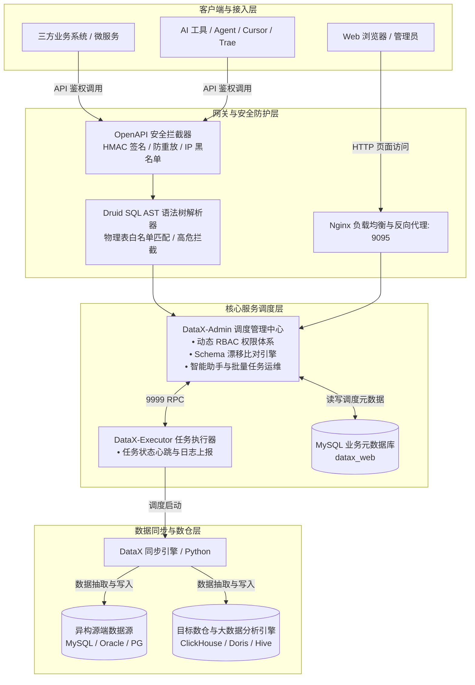

# DataX-Web-Plus 🚀

<p align="center">
  <a href="https://github.com/ericjrex/datax-web-plus">
    
  </a>
  <a href="https://github.com/WeiYe-Jing/datax-web">
    
  </a>
  
  
  
</p>

> **基于 DataX-Web 深度二次开发的企业级数仓集成、元数据自适应演进与安全开放网关平台**  
> *An enhanced enterprise-grade DataX-Web platform featuring warehouse integration, schema drift auto-evolution, secure OpenAPI gateway, and AI-driven automation.*

---

## 📖 项目简介 / Introduction

**DataX-Web-Plus** 是在开源项目 [DataX-Web](https://github.com/WeiYe-Jing/datax-web) 基础之上进行的深度企业级增强与二次开发。

原版 DataX-Web 提供了开箱即用的 DataX 可视化全流程任务配置与调度能力。而在复杂的企业数仓集成与数据中台演化场景中，往往面临**表结构漂移失控、外部系统/AI 工具取数安全无保障、多租户行级数据隔离缺失、以及大批量任务运维低效**等痛点。

本项目针对上述实际痛点，在保持原调度内核稳定的前提下，深度研发了：
1. **Schema 漂移自适应演进引擎**（8 库对比、DDL 批量评审、字段注释演进）；
2. **数仓 OpenAPI 安全网关**（HMAC-SHA256 签名、防重放攻击、SQL AST 语法树安全解析、库表白名单与 IP 现场封禁）；
3. **企业级动态 RBAC 与行级租户隔离**（多角色字典、动态菜单权限、数据源级多字段行级过滤）；
4. **DataX 智能助手与批量运维套件**（内置智能运维面板、支持 MCP 协议、批量改库与跨库对账）。

---

## 🌟 核心特性 / Key Features

### 1. 🔄 Schema 漂移检测与自适应演进 (Schema Drift Auto-Evolution)
- **多库三方 Schema 比对**：支持 MySQL、ClickHouse、Oracle、PostgreSQL、Doris、Hive、SQL Server 等 8 种主流数据库字段元数据实时探查。
- **字段类型跨库智能映射与 DDL 推导**：内置 DataTypeConverter 智能转换器，根据源库表自动推导并生成目标库 CREATE TABLE / ALTER TABLE 语句。
- **字段注释自动演进与批量评审**：自动提取源端与字典备注演进，提供批量 DDL 手动/自动评审工单，防止生产同步任务因上游改表而中断。

### 2. 🛡️ 数仓 OpenAPI 安全网关 (Secure Warehouse OpenAPI Gateway)
- **金融级鉴权验签与防重放**：支持标准 HMAC-SHA256 签名校验（AK/SK 机制），结合 Nonce 随机数缓存实现高效防重放攻击。
- **SQL AST 语法树深度解析与安全审计**：
  - 基于 Druid SQL AST 语法树逐层解析，强制提取物理表清单并比对权限白名单；
  - 刚性拦截写指令（DROP / TRUNCATE / UPDATE / DELETE）及高危探测函数（SLEEP / BENCHMARK / 元数据跨库探测）。
- **细粒度库表授权与 IP 黑名单管控**：支持单账号多库多表白名单配置（JSON 策略）、动态限流 QPS，并支持在调用日志中一键拉黑异常客户端 IP。
- **调用终端与 AI 来源审计**：全链路记录 client_source、User-Agent、执行 SQL、耗时、数据行数与安全拦截状态。

### 3. 👥 动态角色权限与租户级行级隔离 (Dynamic RBAC & Tenant Isolation)
- **系统角色字典动态管理**：扩展 job_role 元数据，支持自定义角色（如开发员、审计员、业务分析师）及动态权限分配。
- **跨账号权限同步与多表勾选查看**：前端管理界面支持一键跨账号复制权限策略，支持海量表的拼音/名称搜索与全选。
- **数据源级多字段行级过滤**：在数据接入端支持根据租户、地区、机构等多维度进行行级 SQL 拼接隔离，保障多租户数据安全。

### 4. 🤖 DataX 智能助手与高效运维套件 (Assistant & Batch Operations)
- **无侵入智能助手面板**：前端内置原生 DOM 构造的高质感侧边助手，无需重构主工程即可快速扩展 Tab 视图。
- **批量任务迁移与改库调度**：支持通过正则或字符串替换批量修改数百个任务的 Reader/Writer 连接串，支持任务批量复制与参数热插拔。
- **任务数据量核对与跨库对账**：提供统计计算任务引擎（StatTaskEngine），自动比对源库与目标库的数据吞吐与日增量差异。
- **支持 MCP 协议生态接入**：提供标准 Python 客户端与 MCP 工具集成，便于通过 Cursor、Trae、WorkBuddy 等 AI 工具直接安全调用数仓数据。

---

## 🏗️ 架构拓扑 / Architecture



---

## 📂 项目结构 / Project Structure

```text
datax-web-plus/
├── bin/                        # 运维、自动化部署与数据库初始化脚本
│   ├── db/                     # 核心数据库脚本 (datax_web.sql, datax_web_stat_task.sql)
│   ├── python/                 # OpenAPI 客户端 Demo 与 MCP 协议支持
│   └── install.sh              # 一键部署与环境自检脚本
├── datax-admin/                # 调度管理核心模块 (Spring Boot)
│   ├── src/main/java/          # 核心控制器、服务层、OpenAPI 安全网关、AST 解析器
│   └── src/main/resources/     # 配置文件、MyBatis Mapper、前端管理静态页面
├── datax-core/                 # 核心公共组件与加解密抽象
├── datax-executor/             # 调度执行器客户端模块
├── datax-rpc/                  # 内部轻量级 RPC 通信框架
└── doc/                        # 技术规范与详细文档
    ├── datax-web/              # 部署手册 (deploy-guide.md) 与系统配置说明
    └── openspec/               # 各特性模块的设计规范与演化提案
```

---

## 🚀 快速上手 / Quick Start

### 1. 环境准备
- **Java**: JDK 1.8+
- **Python**: Python 2.7 或 Python 3.x（用于运行 DataX 引擎）
- **Maven**: 3.3+
- **MySQL**: 5.7+ / 8.0+

### 2. 初始化数据库
在 MySQL 中执行初始化脚本：
```bash
mysql -u root -p < bin/db/datax_web.sql
mysql -u root -p < bin/db/datax_web_stat_task.sql
```

### 3. 配置数据库连接
修改 datax-admin/src/main/resources/bootstrap.properties 中的数据库配置（支持通过系统环境变量覆盖）：
```properties
DB_HOST=127.0.0.1
DB_PORT=3306
DB_USERNAME=root
DB_PASSWORD=your_password
DB_DATABASE=datax_web
```

### 4. 编译与打包
```bash
mvn clean package -DskipTests
```

### 5. 详细部署与生产运维手册
关于 Nginx 反向代理配置、启停脚本、跨环境迁移与发版运维，请参阅：  
👉 **[生产部署与运维完整指南 (doc/datax-web/deploy-guide.md)](doc/datax-web/deploy-guide.md)**

---

## 🔒 安全说明 / Security Notice

1. **凭证脱敏**：本项目开源代码已剥离所有生产环境密码与外网 IP 凭据。生产环境建议通过操作系统环境变量（如 DB_PASSWORD）或配置中心注入密码。
2. **OpenAPI 规范**：外部系统调用时，请在管理后台 Tab8（三方开放 API 管理）分配专用的 AppKey 与 AppSecret，严禁在公网透传明文私钥。

---

## 🤝 鸣谢 / Acknowledgements

- 感谢阿里巴巴开源的高效数据同步引擎 [Alibaba DataX](https://github.com/alibaba/DataX)。
- 感谢 [WeiYe-Jing/datax-web](https://github.com/WeiYe-Jing/datax-web) 提供的开箱即用可视化调度基线。

---

## 📄 开源许可 / License

本项目遵循 [Apache-2.0 License](LICENSE) 开源协议。