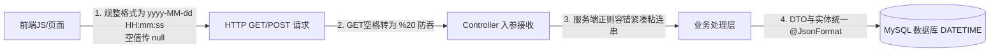

# DataX Web 智能助手前后端统一设计与开发规范 (Assistant Development Spec)

> **版本**：v1.0.0  
> **作者**：ypc  
> **适用范围**：DataX-Web 智能助手前端（Tab1~TabN、Components、Core）、后端（Controller、Service、Mapper、Engine）及新增功能开发

---

## 目录
1. [设计哲学与基本原则](#一设计哲学与基本原则)
2. [文案与反馈规范（讲人话，贴合 DataX-Web）](#二文案与反馈规范讲人话贴合-datax-web)
3. [时间与日期处理铁律](#三时间与日期处理铁律)
4. [增量同步与查询规范](#四增量同步与查询规范)
5. [前端开发与 UI 交互规范](#五前端开发与-ui-交互规范)
6. [后端架构与分层编码规范](#六后端架构与分层编码规范)
7. [数据库变更与 SQL 沉淀规范](#七数据库变更与-sql-沉淀规范)
8. [AI 智能体研发十大禁忌（红线）](#八ai-智能体研发十大禁忌红线)

---

## 一、设计哲学与基本原则

1. **贴合原生生态，拒绝生造概念**：
   - 智能助手是 DataX-Web 的增强插件与赋能工具，必须与 DataX 的核心模型（读/写插件、作业配置、调度触发、执行日志）概念完全统一。
   - 严禁为了显得“高大上”生搬硬套流计算、学术论文里的非业务名词（例如将“增量时间更新”称为“水位线推进”，将“读写记录数”称为“流吞吐量”等）。
2. **通俗易懂（说人话）**：
   - 所有给用户看的状态反馈、提示、气泡、日志摘要，必须用一线数据开发和运维人员一眼能懂的语言表达。
3. **高兼容性与防御性编程**：
   - 前后端对时间、网络编码、脏数据、空值进行全链路容错，杜绝偶发异常打断业务流程。

---

## 二、文案与反馈规范（讲人话，贴合 DataX-Web）

### 1. 执行成功文案标准模板
统一采用 DataX Web 官方量词与动词体系：
- **计数量词**：严禁使用“行/Rows”，统一使用 **“条”**（如 `读取 2 条，写入 2 条`）。
- **动作动词**：读取数据源用 **“读取”**（Reader），写入数据源用 **“写入”**（Writer）或 **“入库”**。
- **增量时间**：严禁出现“水位线”，统一表述为 **“下次增量时间”** 或 **“增量时间已更新至”**。
- **耗时表达**：耗时小于 1000ms 显示毫秒（如 `243ms`），大于等于 1000ms 自动转为秒（如 `2.15s`）。

#### 规范范式：
```text
增量任务成功：
🎉 任务执行成功：读取 {M} 条，写入目标表 [{tableName}] {N} 条，耗时 {time}（下次增量时间: {yyyy-MM-dd HH:mm:ss}）

全量任务成功：
🎉 任务执行成功：读取 {M} 条，写入目标表 [{tableName}] {N} 条，耗时 {time}

弹窗展示：
直接展示单行或轻量换行，避免“🎉 执行成功！\n任务执行成功：...”等套娃重复。
```

### 2. 执行失败与异常文案标准模板
- 格式：`任务执行失败 (耗时 {time}): {简要原因}`
- 统一剔除无意义的底层框架堆栈前缀，突出业务失败核心（如 `表 ods_xxx 不存在`，`字段 mapping 缺失`）。

### 3. 表格状态徽章（Badge）统一
- **🟢 成功 / 运行中**：颜色 `#52c41a`，背景 `#f6ffed`，边框 `#b7eb8f`
- **🔴 失败 / 异常**：颜色 `#f5222d`，背景 `#fff1f0`，边框 `#ffa39e`
- **⚪ 未运行 / 已停止**：颜色 `#8c8c8c`，背景 `#fafafa`，边框 `#d9d9d9`
- **🔵 待处理 / 队列中**：颜色 `#1890ff`，背景 `#e6f7ff`，边框 `#91d5ff`

---

## 三、时间与日期处理铁律

历次踩坑经验总结，时间处理必须全链路无死角覆盖：



### 1. 后端实体与 DTO 注解标准
所有 `Date` 类型字段（包括 `incStartTime`、`updateTime`、`lastRunTime` 等）**必须显式声明 Jackson 注解**：
```java
@JsonFormat(pattern = "yyyy-MM-dd HH:mm:ss", timezone = "GMT+8")
private Date updateTime;
```
*严禁省略注解导致 Jackson 默认退化为 ISO-8601 或反序列化崩溃。*

### 2. HTTP GET 请求防空格丢失
- 前端与抽取引擎发起带时间参数的 GET 请求时，必须将空格转换为 `%20`，防止网络底层拆词丢失空格（变成 `2026-09-0708:28:19`）。
- 后端 Controller 解析日期字符串时，必须集成容错补齐逻辑：如检测到 18 位长度紧密相连的 `yyyy-MM-ddHH:mm:ss`，自动在第 10 位补全空格后解析。

---

## 四、增量同步与查询规范

### 1. 业务数据增量 vs 配置元数据增量
- **业务抽取任务（DataX Reader）**：根据具体业务字段（如 `update_time`、`modify_time` 或自增 ID）进行增量过滤，增量起始时间记录在 `job_info.inc_start_time` 中。
- **任务管理配置本身增量采集**：
  - 任务配置表的查询（如 `/api/job/pageList`）增量过滤**必须且只能以物理更新时间 `update_time` 为基准**；
  - 接口入参必须同时兼容小驼峰 `updateTime` 与蛇形 `update_time`；
  - 严禁将任务配置自身的过滤混淆为 `incStartTime`！

---

## 五、前端开发与 UI 交互规范

### 1. 技术栈与架构原则
- **技术选型**：原生 JavaScript (ES6+) + 原生 Vanilla CSS，零引入不可控的庞大第三方重量级库。
- **模块化管理**：
  - 各功能页签严格封装于 `tabs/tab{N}_{name}.js` 中；
  - 公共 DOM 构建与事件总线抽取于 `core/dom_builder.js` 和 `core/event_bus.js`；
  - 悬浮窗、设置、框选等公共交互抽取于 `components/`。
- **禁止内联硬编码散乱颜色**：
  - 统一采用 Ant Design 色系：主色 `#1890ff`，成功 `#52c41a`，错误 `#f5222d`，警示 `#fa8c16`，边框 `#d9d9d9`。

### 2. XSS 与安全渲染规范
- 任何从后端接口返回的文本（任务名、表名、URL、日志、SQL等）直接写入 `innerHTML` 时，**必须使用 `safeEscapeHtml(...)` 转义**。
- 详情/快照弹出框统一使用 `encodeURIComponent` 绑定到属性中，点击时由公共弹窗解压渲染。

---

## 六、后端架构与分层编码规范

### 1. Google 编程规范与中文注释
- 所有新增类、接口、核心公共方法必须带有标准的 Javadoc 中文注释，说明职责、参数与返回值。
- 严禁在文件或行内私自添加多余作者信息（仅全新创建的文件头可写 `author: ypc`）。

### 2. 统一响应封装
- 接口统一返回 `ReturnT<T>`，成功状态码使用 `ReturnT.SUCCESS_CODE` (200)，失败使用 `ReturnT.FAIL_CODE` (500)。
- Controller 类统一继承 `BaseController`，禁止全类名引用，统一在文件头部 `import`。

### 3. MyBatis 映射器避坑准则
- **严禁在 Mapper 接口中声明同名的抽象重载方法**！MyBatis XML 依赖方法名作为 `<select id="...">` 映射，同名方法会导致 Statement ID 冲突。
- 若需要保持向下兼容，必须采用 Java 8 `default` 缺省接口方法提供参数适配转发。

---

## 七、数据库变更与 SQL 沉淀规范

每次功能开发若涉及数据库表结构变动，必须遵守以下步骤：
1. **自动生成幂等 DDL 升级脚本**：
   - 文件命名规范：`bin/db/datax_web_{模块名}_{版本/变更名}.sql`。
   - 字段扩展必须具备幂等性（如使用存储过程或显式检查，或者标准 `ALTER TABLE ... ADD COLUMN ...` 并附带回滚说明）。
2. **基线 SQL 同步更新**：
   - 核心库基础表同步更新至 `bin/db/datax_web.sql`；
   - 专用任务表更新至对应的建表文件（如 `bin/db/datax_web_stat_task.sql`、`bin/db/ods_datax_job_info.sql` 等）。

---

## 八、AI 智能体研发十大禁忌（红线）

后续所有 AI 助手在协助本工程迭代新功能时，必须严格遵守以下红线，违者视为严重事故：

1. 🚫 **严禁格式化已有旧代码**：修改现有代码必须精准按行替换，避免引发几十万行无意义 diff。
2. 🚫 **严禁删除已有 class 或 target 文件**：避免导致本地正在运行的 Spring Boot 调试进程报错。
3. 🚫 **严禁生造概念和异想天开的文案**：禁止在用户反馈里使用“水位线”、“拉取行”等行话，一律使用“读取x条，写入x条，下次增量时间”。
4. 🚫 **严禁在 Java Mapper 接口中新增同名重载方法**：导致 MyBatis 初始化 Statement 异常。
5. 🚫 **严禁省略 `@JsonFormat` 日期反序列化注解**：所有新增实体及 DTO 的 `Date` 字段必须声明标准时区和格式。
6. 🚫 **严禁在已有代码和修改行内添加个人作者信息**：仅允许全新建文件时标注 `author: ypc`。
7. 🚫 **严禁使用全类名编程**：必须在头部规范 import 包名。
8. 🚫 **严禁有表字段变更而不产出 SQL 脚本**：新增或修改字段必须同步在 `bin/db/` 落地 SQL 文件。
9. 🚫 **严禁出现重复逻辑不抽公共方法**：超过两次出现的逻辑必须抽取为公共辅助方法。
10. 🚫 **严禁对 OASystem 执行 mvn 命令**。
