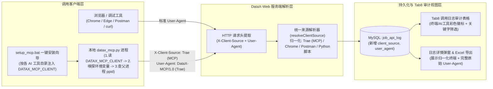

# Design: Tab8 调用日志审计新增调用终端与 AI 工具来源识别

## Context

在 OpenAPI 实际运营中，管理员需要区分某次查询究竟来自哪个具体的 AI 工具（如 Trae、WorkBuddy、Qoder、DeepSeek Harness、OpenCode、Codex、Antigravity、Cursor）、哪个浏览器（Chrome / Edge / Firefox / Safari），还是某个调试工具（Postman / Apifox / curl）或野生 Python 脚本。由于所有本地 MCP 工具均通过 `python datax_mcp.py` 转发 HTTP 请求，若不在本地 MCP 端做宿主识别与 Header 透传，服务端只能看到千篇一律的 `python-requests/2.x`。详见 `proposal.md - Why`。

## Goals / Non-Goals

**Goals:**
- 在 `setup_mcp.bat` 与 `datax_mcp.py` 中实现**三层宿主 AI 工具自动识别**（配置文件 `DATAX_MCP_CLIENT` 环境变量注入 -> 宿主机特征环境变量嗅探 -> 父进程树 `ppid` 进程名探测），并通过 HTTP Header `X-Client-Source` 与 `User-Agent` 发送给网关；
- 在服务端构建统一、零外部依赖的 `ClientSourceParser`（集成于 `JobApiLogService`），自动将 `X-Client-Source` 和 `User-Agent` 解析为简明易读的 `clientSource`（如 `Trae (MCP)`、`WorkBuddy (MCP)`、`Chrome 130`、`Postman`、`Python 脚本`）；
- 扩展 `job_api_log` 表新增 `client_source` 和 `user_agent` 两个字段（带后端 `@PostConstruct` 自动平滑升级列兜底），并在 Tab8 调用日志列表、筛选栏、详情弹窗和 Excel 导出中全链路展示。

**Non-Goals:**
- 不将客户端上报的 `X-Client-Source` / `User-Agent` 作为安全鉴权放行依据（HTTP 请求头可被客户端伪造，仅用于审计观测与统计归因，安全防线仍由 AK/SK 签名与 IP 黑白名单保障）。

## Architecture & Security Audit

### 1. 调用终端与 AI 工具识别架构图

### 2. 安全性审计 (Security Audit)

1. **防止伪造 Header 注入（XSS 与超长攻击防护）**：
   - 客户端传入的 `X-Client-Source` 和 `User-Agent` 属于不可信外部输入。服务端在入库前强制过滤控制字符并截断长度（`client_source` 限制 `<= 120` 字符，`user_agent` 限制 `<= 500` 字符）；
   - 前端 `tab8_open_api.js` 渲染 `clientSource` 徽标与详情弹窗 `userAgent` 时，100% 经过 `safeEscapeHtml` 转义，彻底杜绝反射型或存储型 XSS（例如攻击者在 `User-Agent` 中注入 `<script>`）。
2. **仅作审计归因，绝不干预鉴权门禁**：
   - `X-Client-Source` 和 `User-Agent` 仅用于填充 `job_api_log` 的审计字段，严禁任何基于 `User-Agent` 跳过签名或放行权限的逻辑。
3. **本地父进程探测安全降级**：
   - `datax_mcp.py` 在探测宿主机父进程名时设置严格超时（`<= 0.5s`）并捕获全部异常，任何受限环境下失败均静默回退为 `MCP Client (Python)`，绝不阻塞正常 MCP 工具调用。

## Decisions

### Decision 1: 在 `job_api_log` 同时保存归一化 `client_source` 与原始 `user_agent`
- **选择**：在 `job_api_log` 新增 `client_source varchar(128)` 与 `user_agent varchar(512)` 两列。
- **理由**：列表展示与筛选需要简短直观的标签（如 `Trae (MCP)`、`Chrome 130`），而安全溯源时管理员在详情弹窗中需要查看完整的原始 `User-Agent` 字符串。双字段兼顾了列表可读性、SQL `LIKE` 检索性能与取证完整性。

### Decision 2: `datax_mcp.py` 三层宿主 AI 工具识别策略
- **选择**：
  1. **优先级 1（环境变量 `DATAX_MCP_CLIENT`）**：`setup_mcp.bat` 在写入 `%APPDATA%/Trae/...`、`~/.workbuddy-ai/...`、`~/.qoder/...`、`~/.gemini/...`、`~/.dsh/...`、`opencode.json`、`~/.codex/config.toml`、`~/.cursor/...` 等具体路径时，直接写入对应的 `"DATAX_MCP_CLIENT": "Trae"` 等精确值；
  2. **优先级 2（宿主特征环境变量扫描）**：检查当前进程环境变量键名/键值是否包含 `TRAE`、`WORKBUDDY`、`CODEBUDDY`、`QODER`、`ANTIGRAVITY`、`DEEPSEEK`、`OPENCODE`、`CODEX`、`CURSOR`、`WINDSURF`、`CLAUDE`、`VSCODE`；
  3. **优先级 3（父进程树嗅探）**：通过 `os.getppid()` 检查父进程名是否匹配上述 IDE 进程。

## Risks / Trade-offs

- **[Risk] 存量已下载旧版 `datax_mcp.py` 的客户端未携带 `X-Client-Source`** → **Mitigation**: 服务端解析器看到 `python-requests/2.x` 且无 `X-Client-Source` 时，优雅识别为 `Python 脚本 / 旧版MCP`，用户重新执行一次 `setup_mcp.bat` 即可升级为精准 AI 工具名称。
- **[Risk] 存量数据库 `job_api_log` 升级未手动执行 ALTER SQL** → **Mitigation**: 在 `JobApiLogServiceImpl` 的 `@PostConstruct` 中自动检查 `information_schema.COLUMNS` 并幂等执行 `ALTER TABLE job_api_log ADD COLUMN`，确保零人工干预无缝运行。

## Migration Plan

1. 在 `bin/db/datax_web_stat_task.sql` 末尾追加 `job_api_log` 新增 `client_source`、`user_agent` 字段的兼容 `ALTER TABLE` 语句；
2. 后端 `JobApiLogServiceImpl` 启动时自动幂等补齐该字段；
3. 前端更新 `open_api_templates.js` 与 `tab8_open_api.js`，对历史无 `client_source` 的旧日志平滑显示为 `-`。
