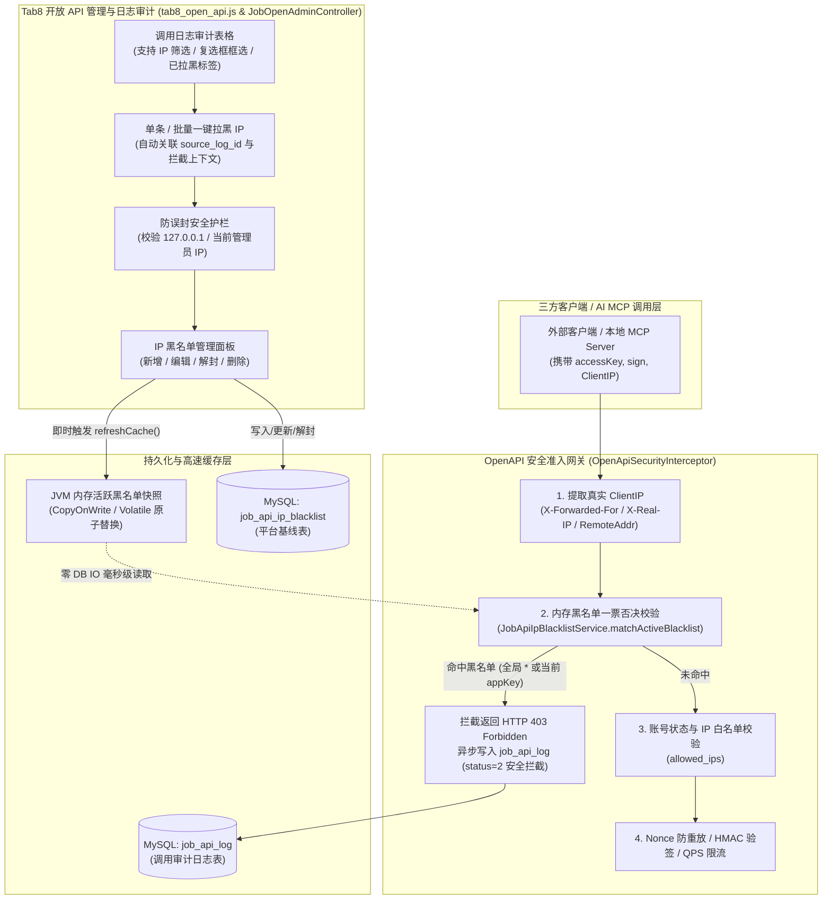

# Design: Tab8 调用日志审计新增 IP 黑名单管控与一键封禁

## Context

当前开放 API 模块（`JobOpenApiController`、`OpenApiSecurityInterceptor`、`tab8_open_api.js`）仅在 `job_api_account` 表中提供静态 `allowed_ips`（白名单）字段。但在实际使用中，大量 AI 提数终端（如办公网动态 IP、多开发者本地 MCP 客户端）无法预设固定白名单，管理员通常将 `allowed_ips` 留空。当在 Tab8「调用日志审计」中观察到异常 IP 发起越权表探测、高频刷接口或恶意慢查询时，无法从审计日志现场直接封禁该 IP。详见 `proposal.md - Why`。

## Goals / Non-Goals

**Goals:**
- 建立独立的开放 API 客户端 IP 黑名单表 `job_api_ip_blacklist`，同时支持**全局封禁（`app_key = '*'`）**与**单账号封禁（指定 `app_key`）**；
- 支持精确 IPv4/IPv6、星号通配符（如 `192.168.1.*`）与 CIDR 网段（如 `10.0.0.0/24`）匹配；
- 在 `OpenApiSecurityInterceptor` 中实现**内存级高速缓存 + 黑名单一票否决（优先于白名单与签名计算）**，确保正常请求零数据库 IO 损耗，并在拦截时写入 `job_api_log`（`status = 2` 安全拦截）；
- 在 Tab8「调用日志审计」中支持按客户端 IP 筛选、表格复选框多选（含 Shift 连续选与 `MarqueeSelector` 矩形框选）、单条/批量选中日志一键加入 IP 黑名单、已拉黑状态徽标高亮与一键解封；
- 内置回环地址（`127.0.0.1`、`::1`、`localhost`）与当前管理员 IP 的防误封二次确认保护；
- 提供 IP 黑名单集中管理视图（弹窗或子标签页），支持黑名单 CRUD 与启停。

**Non-Goals:**
- 不引入外部 Redis 或分布式防火墙组件，直接基于平台 MySQL + JVM 内存缓存（`Volatile` 快照 / Guava Cache）实现，保持架构轻量、稳定、零外部依赖；
- 不影响 DataX-Web 主控台自身的后台登录（仅作用于 `/api/open/v1/**` 开放 API 网关）。

## Architecture & Security Audit

### 1. 系统全链路架构图

### 2. 安全性审计 (Security Audit)

1. **权限越权防护（RBAC）**：
   - 所有黑名单管理接口（`/api/open/admin/blacklist/**`）强制执行 `isCurrentAdmin(request)` 校验，非 `ROLE_ADMIN` 角色一律拒绝访问。
2. **拒绝优先原则（Deny Overrides Allow）**：
   - 黑名单校验置于 `OpenApiSecurityInterceptor` 最前置环节。即便某个 IP 曾被配置在账号的 `allowed_ips` 白名单中，一旦被加入黑名单（且 `status = 1`），立即一票否决拦截，防止白名单配置滞后导致的漏放。
3. **防 DoS 与零 DB 穿透**：
   - 恶意 IP 被拉黑后可能继续高频发起请求。网关层通过内存快照直接匹配黑名单，无需查询数据库即可在微秒级拒绝请求；同时对同一黑名单 IP 的拦截审计日志写入可做轻量限频（例如同一 IP 每分钟最多记录若干条黑名单拦截日志或异步落库），避免恶意洪泛撑爆 `job_api_log` 表。
4. **防本机/网关自锁（Anti-Lockout）**：
   - 前端与后端双重识别回环地址（`127.0.0.1`、`0:0:0:0:0:0:0:1`、`::1`、`localhost`）及当前操作管理员自身所在的请求 IP。前端触发醒目二次确认弹窗，后端接口支持 `forceConfirm` 标识，防止一键批量勾选日志时无意中把本地环回地址拉黑。
5. **XSS 与 SQL 注入防御**：
   - 前端渲染 `ipAddress`、`reason`、`clientIp` 等所有动态字段时强制经 `safeEscapeHtml` 转义；后端使用 MyBatis-Plus 预编译参数化查询，严禁拼接 SQL。
6. **日期序列化与 URL 空格容错**：
   - `JobApiIpBlacklist` 实体中 `createTime`、`updateTime` 均显式声明 `@JsonFormat(pattern = "yyyy-MM-dd HH:mm:ss", timezone = "GMT+8")`。

## Decisions

### Decision 1: 独立表 `job_api_ip_blacklist` vs 在 `job_api_account` 增加 `blocked_ips` 字段
- **选择**：新建独立系统表 `job_api_ip_blacklist`（同时支持 `app_key = '*'` 全局拉黑与指定 `app_key` 账号级拉黑）。
- **理由**：
  1. 审计日志中发现的恶意探测 IP 往往需要对**整个开放 API 平台**全局封禁（默认 `app_key = '*'`），而不仅限于单个账号；同时保留按特定 `app_key` 定向封禁的灵活性；
  2. 独立表可以完整记录**封禁原因 (`reason`)**、**关联触发的审计日志 ID (`source_log_id`)**、**封禁时间 (`create_time`)** 与**操作人 (`create_by`)**，满足安全合规审计溯源要求，而逗号分隔字段无法承载元数据且难以分页检索。
- **备选方案**：在 `job_api_account` 表增加 `blocked_ips` 逗号分隔字符串。缺点是无法全局封禁、无法记录封禁原因与来源日志 ID、日志列表难以高效联动。

### Decision 2: 网关黑名单高速缓存与即时刷新机制
- **选择**：在 `JobApiIpBlacklistServiceImpl` 内置 `volatile List<JobApiIpBlacklist> activeCache`（配合 60 秒定时兜底刷新 + 管理端增删改时主动调用 `refreshCache()`）。
- **理由**：开放 API 网关对延迟敏感，内存快照匹配耗时 `< 0.05ms`，管理端在 Tab8 点击“拉黑IP”或“解封IP”后立即同步刷新内存引用，毫秒级生效。

### Decision 3: Tab8 界面交互布局与操作闭环
- **选择**：
  1. **顶部子选项卡扩展或日志栏快捷按钮**：在 Tab8 顶部子选项卡栏增加第 3 个子标签页 `IP 黑名单`（并实时显示当前生效黑名单数量徽标，如 `IP 黑名单 (2)`），同时在「调用日志审计」筛选栏右侧提供 `批量拉黑选中IP` 按钮；
  2. **日志表格增强**：
     - 首列增加复选框（支持全选、单选、Shift 连续选与 `MarqueeSelector` 框选）；
     - 筛选栏增加 `筛选客户端IP` 输入框；
     - 「客户端IP」列旁若命中当前生效黑名单，渲染红底标签 `已拉黑`；
     - 「操作」列在 `🔍 详情` 旁提供纯文本按钮 `拉黑IP`（若已拉黑则显示绿字 `解封IP`）；
  3. **一键拉黑确认弹窗**：点击单行 `拉黑IP` 或顶部 `批量拉黑选中IP` 时，弹出紧凑确认框，默认选中「全局封禁（所有 API 账号）」或「仅封禁当前账号」，自动带出封禁原因（如 `从调用日志 #1024 拉黑 [原状态: 安全拦截]`），确认后直接落库生效。

## Risks / Trade-offs

- **[Risk] 反向代理（Nginx）未透传真实 IP 导致封禁代理节点 IP** → **Mitigation**: 在拉黑确认弹窗中提示当前 IP 来源；若检测到内网网段或本机回环地址，弹出防误封风险提示，且在「IP 黑名单」标签页支持随时一键解封。
- **[Risk] 被封禁 IP 持续高频洪水攻击导致审计日志膨胀** → **Mitigation**: 在 `OpenApiSecurityInterceptor` 中对同一黑名单 IP 的拦截审计日志采用本地缓存限频（如同一 `(clientIp, appKey)` 每 60 秒仅落库记录 1 次黑名单拦截日志，其余直接 403 拒绝），兼顾安全留痕与存储保护。

## Migration Plan

1. 在 `bin/db/datax_web_stat_task.sql` 末尾追加 `job_api_ip_blacklist` 建表 DDL（使用 `CREATE TABLE IF NOT EXISTS`）；
2. 部署后端新增的 Entity、Mapper、Service 及 Controller/Interceptor 逻辑（应用启动或首次请求时若表为空自动容错）；
3. 前端 `tab8_open_api.js` 增量加载新视图与交互，完全兼容存量账号与审计日志数据。
